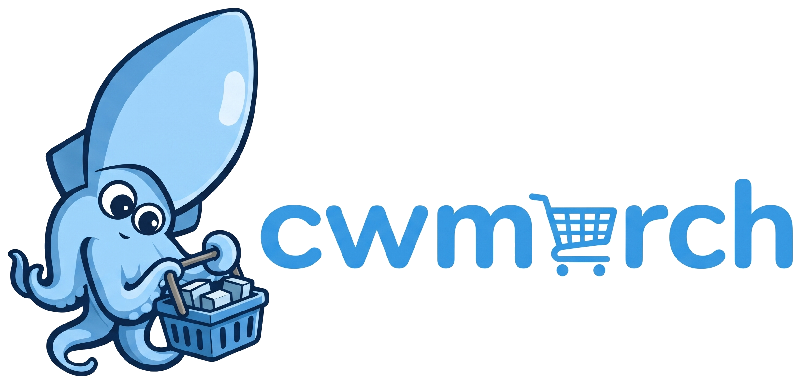

# cwmerch



**cwmerch** is an open-source, lighter remake of [WooCommerce](https://woocommerce.com) written in
Go (API) and React (UI). It works **directly on a WordPress/WooCommerce MySQL or MariaDB database** —
the same tables, the same users, the same orders — **or on PostgreSQL**, so it can:

* run **alone** (a fresh install creates the WooCommerce schema with Flyway), or
* run **alongside an existing WooCommerce shop**, sharing its database: what cwmerch changes,
  WooCommerce sees, and the other way round. There is no other link to WordPress (no plugin, no REST
  call), only the database;
* run your WooCommerce shop **on PostgreSQL** — something WooCommerce users have dreamed of for years:
  the same schema exists for PostgreSQL, and *Clone data* moves a shop from MySQL/MariaDB to PostgreSQL
  (or back) from the administration — see [PostgreSQL and clone data](#postgresql-and-clone-data);
* or be used **only as an AI agent for WooCommerce** (plus API keys, MFA and accounting exports),
  without replacing anything: then only the API is needed — see
  [API-only mode](#api-only-mode-an-ai-agent-for-woocommerce).

Public repository: https://gitlab.cwcloud.tech/oss/cwcloud/cwmerch.git — documentation:
https://www.cwcloud.tech/docs/tutorials/cwmerch

## Features

The WooCommerce features, on WooCommerce's own storage:

* **Storefront**: home page (hero banner slider, categories, featured / new / on-sale products), catalogue
  with filters (category, tag, price, on sale) and sorting, product pages (gallery, variations, attributes,
  stock, reviews, related products), cart (coupons, shipping estimate), checkout (billing/shipping, guest or
  account, shipping and payment methods), "order received" page, customer account (orders, downloads,
  addresses, account details).
* **Products**: simple, variable (attributes, variation generation), grouped, external; sale prices and
  schedules, stock management and backorders, downloadable/virtual products, categories, tags, global
  attributes, shipping classes, images (shared `wp-content/uploads`), catalogue visibility, featured,
  upsells and cross-sells, duplicate, trash/restore. `wc_product_meta_lookup` is kept in sync.
* **Orders**: HPOS tables (`wc_orders`…) or legacy `shop_order` posts (and both when WooCommerce's
  compatibility sync is on), statuses with WooCommerce's side effects (stock reduction/restoration, total
  sales, coupon usage, download permissions, paid/completed dates), notes (private or to the customer),
  refunds (with restock), manual orders. The analytics tables (`wc_order_stats`, `wc_order_product_lookup`,
  `wc_customer_lookup`, coupon and tax lookups) are updated so WooCommerce's own reports include them.
* **Pricing**: taxes (classes, rates by country/state/postcode/city, compound, prices entered with or
  without tax, display incl./excl.), shipping zones and methods (flat rate with cost formulas and shipping
  classes, free shipping, local pickup), coupons (percent, fixed cart, fixed product, every restriction),
  offline payment gateways (bank transfer, cheque, cash on delivery).
* **Customer emails**: WooCommerce's transactional emails (new order, processing, on-hold, completed,
  refunded, cancelled, failed, customer note, invoice, new account) honouring the shop's email settings,
  sent through the **CWCloud email API**. WordPress never runs its hooks for orders cwmerch changes,
  so cwmerch replicates them.
* **Back office**: dashboard, orders, products, categories, tags, attributes, coupons, customers, reviews
  moderation, reports (sales, top products/categories, stock, customers), settings (general, products,
  tax, shipping, payments, accounts, emails, advanced), users, audit trail, IP bans.

Plus:

* **Long-term API keys** (`X-Api-Key`).
* **Sign in with Google** (OIDC; GitHub and Keycloak are available too).
* **MFA** with a TOTP app or a **YubiKey** / security key (WebAuthn).
* **AI assistant** with an agentic loop: the model calls cwmerch's own API with the signed-in user's
  JWT (so it can only do what the user may do), guided by embedded Markdown skills, and only writes after
  an explicit confirmation. AI subscriptions (OpenAI, Anthropic, Mistral, Gemini, OpenRouter, DeepSeek,
  CWCloud) are per user and **shareable with other users**.
* **CWCloud AI adapter**: `POST /v1/ai/cwcloud/adapter` lets CWCloud use cwmerch's assistant as a CWAI
  external adapter.
* **Accounting exports** for the accounting department: *chiffre d'affaires* (turnover), *balance* and
  *grand livre* (general ledger) as JSON or PDF — also available to the AI assistant as tools.
* **Discord notification on every user action**, plus errors and emails.
* **OpenTelemetry** logs, metrics and traces (OTLP gRPC/HTTP) and **Prometheus** metrics (`/metrics`).
* **Swagger UI** at the API root `/`, generated from the router (`/openapi.json`) with request payloads
  and query parameters.
* **SEO**: server-rendered `<head>` (title, description, canonical, Open Graph, Twitter cards, JSON-LD
  Product/Breadcrumb/Organization) for the home, shop, category and product pages, `sitemap.xml`,
  `robots.txt`.
* **Appearance**: shop name, logo, favicon, home banner slides, 8 colour themes (classic, garden, rose,
  ocean, sunset, midnight, minimal, luxury), fonts, corner radius, announcement bar, home sections, social
  links and **custom CSS**.
* **Forgotten password** and **contact form** (CWCloud `contactreq`).
* **Languages**: English, French and **Arabic** (right-to-left layout) for the storefront, the customer
  account, the back office, the emails and the AI assistant; the shop chooses which languages it offers
  and its default one (*Settings → Shop*). PDF exports (invoices, accounting) stay in English or French.
* **Public shop switch**: turn the storefront off and use cwmerch as an internal information system
  (back office, accounting, AI), with sign-up closed if wanted.
* **Online payments** with pluggable adapters: **Stripe** (PaymentIntent + Stripe.js, signed webhook),
  **Konnect** and **Flouci** (hosted payment pages, webhooks verified with the provider), configured from
  the administration with credentials sealed in the database. Without any payment partner, checkout gives
  the customer an **order number** and requires a **phone number** so the shop calls back to confirm.
* **Invoices** from an editable **Markdown / Go template** rendered to PDF, numbered without gaps, with
  **VAT** and/or **timbre fiscal** (fiscal stamp), and defaults per country from an editable **decision
  table** keyed by ISO country code (AE, AU, BE, CA, CH, CI, CM, DE, DZ, EG, ES, FR, GB, IT, LU, MA, NL,
  PT, SA, SN, TN, US and a fallback).

## Architecture

| Path | What it is |
|---|---|
| `cwmerch-api/` | Go API (chi, database/sql + MySQL driver). `internal/woo` is WooCommerce's storage, `internal/store` cwmerch's own tables, `internal/handlers` the HTTP layer. |
| `cwmerch-ui/` | React (Vite, plain JavaScript): storefront, customer account, back office and AI assistant. |
| `cwmerch-db/` | Flyway migrations: `V1` the WooCommerce schema, `V2` cwmerch's `cwmerch_*` tables, `V3` WooCommerce's default options and terms. |
| `.docker/nginx/` | The UI's nginx config (SPA, SEO pages loaded from the API's public URL) and entrypoint (`envsubst`). |
| `docs/API.md` | Overview of the API (the exhaustive reference is the generated OpenAPI). |
| `ci/` | Delivery: builds and pushes the `cwmerch-api` and `cwmerch-ui` images to the registry. |

## Quick start (Docker Compose, fresh install)

```bash
git clone https://gitlab.cwcloud.tech/oss/cwcloud/cwmerch.git && cd cwmerch
cp .env.example .env        # set JWT_SECRET (openssl rand -base64 48) and the passwords
docker compose up -d --build
```

* Shop: http://localhost:3000 — the **first account registered becomes the administrator**.
* API and Swagger UI: http://localhost:8080 (`/openapi.json`, `/metrics`).

The compose file starts MySQL 8.4 (or PostgreSQL 17 with `DB_TYPE=postgres` and
`COMPOSE_PROFILES=postgres` in `.env`), runs the Flyway migrations, then the API and the UI.

The images are published on `rg.fr-par.scw.cloud/cwmerch-eesgg6` (`cwmerch-api`, `cwmerch-ui`,
tagged with the version, `version-sha` and `latest`): to pull them instead of building,

```bash
docker pull rg.fr-par.scw.cloud/cwmerch-eesgg6/cwmerch-api:latest
docker pull rg.fr-par.scw.cloud/cwmerch-eesgg6/cwmerch-ui:latest
```

or `docker compose pull api ui && docker compose up -d` (`VERSION=1.4.0` in `.env` pins a version,
`REGISTRY` overrides the registry).

## Database

cwmerch uses WordPress' table prefix (`DB_TABLE_PREFIX`, default `wp_`). The migrations use the Flyway
placeholder `${table_prefix}` (`-placeholders.table_prefix=wp_`).

### Fresh install

Nothing to do: the `flyway` service applies (from `cwmerch-db/mysql` or `cwmerch-db/postgresql`, following
`DB_TYPE`) `V1__woocommerce_schema.sql` (the WordPress 7.1 + WooCommerce
11.3 schema), `V2__cwmerch_tables.sql` and `V3__woocommerce_defaults.sql`.

### Alongside an existing WooCommerce instance

The WooCommerce tables already exist, so V1 must be **marked as applied** instead of being run:

1. **Back up the database.**
2. Create Flyway's history table with V1 recorded (checksum `1318371643`, the same whatever the prefix):

   ```bash
   mysql -h <host> -u <user> -p <database> < cwmerch-db/init-existing-instance.sql
   ```

   The script creates `flyway_schema_history` exactly as Flyway 10 does, then:

   ```sql
   INSERT INTO `flyway_schema_history`
     (`installed_rank`, `version`, `description`, `type`, `script`, `checksum`,
      `installed_by`, `execution_time`, `success`)
   SELECT 1, '1', 'woocommerce schema', 'SQL', 'V1__woocommerce_schema.sql', 1318371643,
          SUBSTRING_INDEX(USER(), '@', 1), 0, 1
   FROM DUAL
   WHERE NOT EXISTS (SELECT 1 FROM `flyway_schema_history` WHERE `version` = '1');
   ```

3. Point `.env` at the WordPress database (`DB_HOST`, `DB_NAME`, `DB_USER`,
   `DB_PASSWORD`, `DB_TABLE_PREFIX`) and run the migrations: V2 only **adds** cwmerch's `cwmerch_*`
   tables, V3 only adds the default options and terms that are **missing** (it never overwrites a value).

   ```bash
   docker compose up flyway
   ```

4. Start cwmerch without the bundled database: `docker compose up -d api ui`.

The MySQL user needs `SELECT, INSERT, UPDATE, DELETE` on the WordPress tables, plus `CREATE, ALTER,
INDEX, REFERENCES` for the migrations. MariaDB works with the same JDBC URL
(`jdbc:mysql://host:3306/db?allowPublicKeyRetrieval=true&useSSL=false`).

**Sharing images**: mount WordPress' `wp-content/uploads` on the API (`CWMERCH_UPLOADS_DIR`) and set
`CWMERCH_UPLOADS_URL` to its public URL (e.g. `https://myshop.example/wp-content/uploads`): images
uploaded in cwmerch then appear in WordPress' media library and vice versa.

**Passwords**: customers keep one password for both. cwmerch reads every WordPress hash format and
writes WordPress 6.8+'s (`CWMERCH_PASSWORD_HASH=bcrypt`); set `phpass` if an older WordPress shares
the database.

See [cwmerch-db/README.md](cwmerch-db/README.md) for the details.

## API-only mode: an AI agent for WooCommerce

You don't have to replace WooCommerce to use cwmerch. With `CWMERCH_API_ONLY=true`, cwmerch
only serves its API: the **AI assistant** (and the CWCloud adapter), API keys, MFA, Google sign-in,
reports and the **accounting exports**, on your WooCommerce data. WordPress stays the shop and no UI
container is needed.

```bash
# after initialising Flyway's history as above
echo "CWMERCH_API_ONLY=true" >> .env
docker compose up -d flyway api
```

Sign in with your WordPress administrator or shop manager account (same email or username, same
password), add an AI subscription (`POST /v1/ai/connections/`) and chat (`POST /v1/ai/chat`) — or plug it
into CWCloud as a CWAI external adapter (`POST /v1/ai/cwcloud/adapter` with an `X-Api-Key`).

## Permalinks

Product, category, tag and shop pages have **the same addresses as on WordPress**: cwmerch reads
WooCommerce's permalinks (`woocommerce_permalinks`, including `%product_cat%` bases and hierarchical
categories) and the shop page slug, with WooCommerce's localized defaults (`/produit/…` on a French
WordPress). *Settings → Permalinks* edits them in the same option (WordPress rebuilds its rewrite rules).
The UI resolves the paths dynamically. The API's SEO renderer (`/v1/seo/html?path=…`), `/sitemap.xml`
and `/robots.txt` are served publicly by the API; the UI's nginx loads them under its own address from
the API's **public** URL (`CWMERCH_API_URL`, the browser's one), so every non-file, non-app path is
rendered by the API, with a fallback to the plain SPA shell when the API is unreachable. The API fetches
the UI's `index.html` from the UI's public URL (`CWMERCH_UI_URL`). Both URLs must therefore be reachable
from the containers (with `localhost` URLs, as in the default compose, the SEO pages fall back to the SPA).

## Emails and contact form

*Settings → Emails & contact (CWCloud)*: the CWCloud API key is stored in WordPress' `cwcloud-api-secret`
option, shared with the CWCloud WordPress plugin (it wins over `CWCLOUD_API_KEY`), with a test email
button. The contact form goes to a CWCloud contact form when an id is set, else it is emailed to the
recipient read from Contact Form 7 (or WordPress' admin email), editable from the same screen.

## PostgreSQL and clone data

**cwmerch runs on PostgreSQL too** — something WooCommerce users have dreamed of for years. Set
`DB_TYPE=postgres` (the port defaults to 5432) and run the `cwmerch-db/postgresql` migrations: the same
WordPress/WooCommerce + cwmerch schema, lowercase, text columns as `citext` so searches stay
case-insensitive. The API keeps a single set of queries, written in MySQL's dialect, and translates them
at the driver level on PostgreSQL (placeholders, quoting, `INSERT IGNORE` / `ON DUPLICATE KEY UPDATE` →
`ON CONFLICT`, `CAST`, `IF()`, JSON functions, `LastInsertId` → `RETURNING`). WordPress itself only runs
on MySQL/MariaDB: PostgreSQL is for shops run by cwmerch alone (or after leaving WordPress).

*Administration → Clone data* (WordPress administrators) copies all the shop's data between two
databases, in any direction — MySQL/MariaDB → PostgreSQL, PostgreSQL → MySQL, or the same engine:

* **Export**: the main database into a target one; **Import**: a remote database into the main one.
* Both must be migrated (same Flyway version); *Test the connection* compares them first.
* The destination may already hold data: **Overwrite** (default) upserts by primary key, replaces rows
  clashing on another unique key (option name, invoice number…) and replaces the metadata of the posts,
  orders, users… the source has; **Skip** only adds the missing rows.
* Tables are copied parents first (foreign keys) in keyset-paginated batches; zero dates, a different table
  prefix (`<prefix>user_roles`, `<prefix>capabilities`…) and PostgreSQL identity sequences are handled.
* Images (`wp-content/uploads`) are not in the database: copy that folder too. Back up the destination first.

API: `GET /v1/admin/clone`, `POST /v1/admin/clone/test`, `POST /v1/admin/clone`, `GET /v1/admin/clone/job`
(see [docs/API.md](docs/API.md)). The AI assistant can run it too (test, then your explicit yes).

## Shop switch: cwmerch as an internal information system

*Administration → Settings → Shop*: with the public shop off, the storefront endpoints answer 403
(`errors.shopDisabled`) and the UI shows a "closed" page with your message; sign-in, the back office, the
accounting exports and the AI assistant keep working. Customer registration can be closed too.

## Online payments

*Administration → Settings → Payments → Online payments*. Each provider is an adapter
(`cwmerch-api/internal/payments`: `Adapter` interface, one file per provider), so adding another payment
system is one more adapter.

| Provider | Credentials | Webhook to register at the provider | Currencies |
|---|---|---|---|
| Stripe | publishable key, secret key, webhook signing secret | `<API URL>/v1/payments/stripe/webhook` (`payment_intent.succeeded`, `payment_intent.payment_failed`) | any |
| Konnect | API key, wallet id (sandbox or production) | sent automatically with each payment (`<API URL>/v1/payments/konnect/webhook`) | TND, EUR, USD |
| Flouci | public key, private key | sent automatically with each payment (`<API URL>/v1/payments/flouci/webhook`, signed) | TND |

Credentials are sealed with `CWMERCH_SECRET_KEY` (AES-256-GCM) before being stored; they can also come
from the environment (`STRIPE_SECRET_KEY`, `KONNECT_API_KEY`, `FLOUCI_PRIVATE_KEY`…). An order paid online
stays *pending* until the provider confirms the payment (webhook, or the customer coming back to
`/checkout/payment/{id}`), then moves to *processing* with the provider's transaction id — and the usual
WooCommerce emails.

**No payment partner configured**: the checkout requires the customer's phone number, the order is placed
*on hold* and the customer gets the order number with a "we will call you to confirm" message.

## Invoices

*Administration → Settings → Invoicing* (and *Administration → Invoices*):

* numbering `prefix + year + sequence` (or a continuous sequence), without gaps;
* tax mode: **VAT**, **timbre fiscal**, **VAT + timbre fiscal** or **none** (with the exemption mention,
  e.g. "TVA non applicable, art. 293 B du CGI"); the stamp can be charged to the customer at checkout
  (a fee line on the order);
* seller block (registration number such as SIRET / matricule fiscal, VAT number, IBAN), legal mentions,
  payment terms, footer;
* **"Apply country defaults"** fills all of this from the **decision table** (*Country defaults* tab:
  edit any country or add a missing one), optionally creating the standard VAT rate;
* the invoice is a **Go template producing Markdown** (the default one is shown in the editor with every
  variable, and can be previewed as PDF); an issued invoice is frozen (JSON snapshot + Markdown) and can
  be downloaded as PDF or Markdown, emailed with the PDF attached, and downloaded by the customer from
  their account; it can be issued automatically when an order is processing or completed.

## Configuration

| Variable | Default | Meaning |
|---|---|---|
| `DB_TYPE` | `mysql` | `mysql` (also `mariadb`, `my`) or `postgres` (also `postgresql`, `pgsql`, `pg`, `psql`) |
| `DB_HOST`, `DB_NAME`, `DB_USER`, `DB_PASSWORD` | `localhost`, `wordpress`, `wordpress`, — | The (WordPress) database |
| `DB_PORT` | `3306` (MySQL/MariaDB), `5432` (PostgreSQL) | Database port |
| `DB_TABLE_PREFIX` | `wp_` | WordPress table prefix |
| `DB_SSLMODE` | `disable` | PostgreSQL SSL mode |
| `DB_POOL_SIZE` | `10` | Connection pool size |

The former `MYSQL_HOST`, `MYSQL_PORT`, `MYSQL_DATABASE`, `MYSQL_USER`, `MYSQL_PASSWORD`, `MYSQL_POOL_SIZE` and
`WP_TABLE_PREFIX` still work as fallbacks.
| `JWT_SECRET` | — (required) | Session token signing key |
| `CWMERCH_SECRET_KEY` | — | Seals payment credentials stored from the administration (`openssl rand -base64 32`) |
| `STRIPE_*`, `KONNECT_*`, `FLOUCI_*` | — | Payment credentials from the environment (see `.env.example`) |
| `CWMERCH_API_URL` / `CWMERCH_UI_URL` | `http://localhost:8080` / `http://localhost:3000` | Public URLs |
| `CWMERCH_SHOP_URL` | UI URL | Storefront URL for permalinks, canonical links and the sitemap |
| `CWMERCH_CORS_ENABLED`, `CWMERCH_CORS_ALLOWED_ORIGINS` | off, `*` | CORS |
| `CWMERCH_ACTIVATION_MODE` | `auto` | New customer accounts: `auto`, `email` (confirmation link), `admin` (approval) |
| `CWMERCH_PASSWORD_HASH` | `bcrypt` | `bcrypt` (WordPress ≥ 6.8) or `phpass` |
| `CWMERCH_UPLOADS_DIR`, `CWMERCH_UPLOADS_URL` | —, API `/v1/media` | `wp-content/uploads` folder and its public URL |
| `CWMERCH_MAX_UPLOAD_SIZE` | `10485760` | Max image upload (bytes) |
| `CWMERCH_API_ONLY` | `false` | API-only mode (no storefront/back-office routes) |
| `CWMERCH_OIDC_GOOGLE_CLIENT_ID`, `CWMERCH_OIDC_GOOGLE_CLIENT_SECRET` | — | Google sign-in (redirect URI `<API URL>/v1/oidc/google/callback`) |
| `CWCLOUD_API_URL`, `CWCLOUD_API_KEY` | `https://api.cwcloud.tech`, — | CWCloud email API |
| `CWCLOUD_CONTACT_FORM_ID` | — | CWCloud contact form (contact page) |
| `CWMERCH_MAIL_FROM` | `noreply@cwcloud.tech` | Default sender (WooCommerce's "From" address wins when set) |
| `DISCORD_TOKEN` | — | Discord webhook `{id}/{token}` (notification on every user action) |
| `CWMERCH_OTEL_ENDPOINT`, `CWMERCH_OTEL_PROTO` | —, `otlp/grpc` | OpenTelemetry collector (`otlp/grpc` or `otlp/http`) |
| `CWMERCH_AI_DOWNLOAD_DIR`, `CWMERCH_AI_DOWNLOAD_TTL` | `storage`, `30m` | Files generated by the assistant (PDF exports) |

UI container: only `CWMERCH_API_URL` (public API URL for the browser). The build keeps the
`${CWMERCH_API_URL}` placeholder (`cwmerch-ui/.env.dist`) and the entrypoint replaces it with `envsubst`
in the built `.js`, `.css` and `.html` files at start, like comwork-cloud-ui. nginx also loads the SEO
pages, `/sitemap.xml` and `/robots.txt` from that same public URL.

## Development

```bash
docker compose up -d db flyway
```

```bash
cd cwmerch-api && DB_HOST=127.0.0.1 JWT_SECRET=dev CWMERCH_CORS_ENABLED=true go run .
```

```bash
cd cwmerch-ui && npx pnpm@latest install && npx pnpm@latest run dev
```

Checks: `go vet ./... && go test ./...` in `cwmerch-api`, `pnpm run lint && pnpm run build` in
`cwmerch-ui`.

## Delivery

GitLab CI on `main`, like cwclock without its deployment: `mirror` (`ci/mirror.sh`, pushes the repository
to its GitHub mirror) and `build` (`ci/prune.sh` then `ci/deliver.sh`: builds the `cwmerch-api` and
`cwmerch-ui` images with `docker buildx bake` and pushes them to the registry with the version from
`VERSION`, plus `version-sha` and `latest` tags).
Registry: `rg.fr-par.scw.cloud/cwmerch-eesgg6` (`cwmerch-api`, `cwmerch-ui`).

## License

[MIT](LICENSE) © 2026 CWCLOUD SASU.
